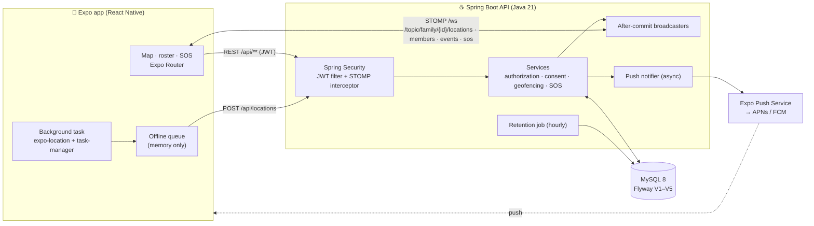

# FamilyMap

A **consent-based** family location-sharing app, a lightweight Life360. A family admin creates
a circle, members join with an invite code, and everyone in the circle sees each other live on
a map, gets "Leo arrived at School" alerts, and can send an SOS.

> **Transparency by design.** Every member opts in on a plain-language screen before any OS
> prompt, always sees a "sharing on" indicator, and can pause per circle at any time. There is
> no hidden or covert mode, and the server enforces consent, not just the app.

| Live map | Consent first | Saved places | SOS |
|---|---|---|---|
|  |  |  |  |

## Features

- **Live map.** Members' markers move in real time over WebSocket/STOMP, with last-seen time,
  battery and an accuracy halo. A *Live / Reconnecting* badge shows when data might be stale.
- **Circles.** Create one, invite with a code or a `familymap://invite/…` link, be in several at
  once. Admins are handed over automatically when the last one leaves.
- **Battery-aware sharing.** Background tracking in installed builds, with three power profiles
  that switch with the battery level and Low Power Mode. Fixes that fail to upload wait in a
  small in-memory queue and go out later with their real timestamps.
- **Places and arrival alerts.** Long-press the map to save Home or School. Arrivals and
  departures are detected on the server with hysteresis and an accuracy gate, then shown as a
  banner and sent as push notifications.
- **SOS.** Hold for 2 seconds to alert every circle you're in with your position, even circles
  you've paused. Helpers see a red banner and pin and can mark it handled.
- **Your data, briefly.** Location points expire after 7 days and SOS alerts after 30.
  *Delete my location history* erases everything at once.

## Architecture



**How a location update flows:** the phone posts a fix. The service stores it only for circles
where the member is sharing, runs the geofence check in the same transaction, and commits.
Only after the commit, broadcasters fan the point and any arrival out to those circles' STOMP
topics, and the push notifier calls Expo's push service off the request thread.

| Layer | Tech |
|---|---|
| Mobile | React Native 0.88 / Expo SDK 58, Expo Router, react-native-maps, @stomp/stompjs, expo-location, expo-task-manager, expo-notifications, expo-secure-store |
| Backend | Java 21, Spring Boot 3.5 (Web, Security, Data JPA, WebSocket, Validation, Actuator) |
| Auth | Stateless JWT (access + refresh), BCrypt |
| Realtime | WebSocket / STOMP, Spring simple broker |
| Database | MySQL 8, Flyway migrations, H2 (MySQL mode) in tests |
| Push | Expo Push Service, which delivers through APNs and FCM |
| Ops | Docker multi-stage image (non-root), docker compose, GitHub Actions, JaCoCo |

## Security & consent design

**Consent is enforced by the server, not just shown by the app.**
- A point is stored and shown only in circles where the member has sharing on. Paused
  everywhere means the point is discarded, not stored. A paused member's last known spot is
  hidden too, and pausing clears their place presence, so resuming never reveals where they went.
- The tracked person always knows: the consent screen comes before any OS prompt, the
  "sharing on" bar is always visible, Android shows a permanent notification and iOS the blue
  location pill. Nothing in the app hides it from its user.
- The one exception is visible and deliberate: **SOS** reaches paused circles, because holding
  it for 2 seconds is an explicit request to be found. The button's accessibility hint says so.

**Authorization lives in the service layer.**
- Every circle-scoped operation, over REST or WebSocket, goes through one check
  (`FamilyAccessService.requireMember`). The STOMP interceptor applies the same rule to
  `SUBSCRIBE`, and clients can never `SEND` directly to a `/topic`.
- Strangers get **404, not 403**, so circle ids can't be probed.
  [`AuthorizationIntegrationTest`](backend/src/test/java/com/familymap/controller/AuthorizationIntegrationTest.java)
  pins this down endpoint by endpoint.
- Rosters never expose emails. Members see name, avatar, role and sharing status only.

**Credentials and tokens.**
- BCrypt passwords. Login gives the same answer, in about the same time, for an unknown email
  and a wrong password, so accounts can't be enumerated.
- 15-minute access tokens and 7-day refresh tokens with a typed claim, so one can't be used as
  the other. The app keeps them in the iOS Keychain / Android Keystore (`expo-secure-store`).
- The JWT travels in the STOMP `CONNECT` frame, never in a URL where access logs would keep it.
- The API refuses to start without a JWT secret of at least 256 bits. Every secret comes from env vars.

**Data minimization.** Locations expire after 7 days and SOS alerts after 30, purged hourly in
small batches. The offline queue never touches disk. Arrival history isn't stored, only
"who is inside which place now". Push tokens are removed on sign-out, so a shared phone
doesn't keep getting someone else's alerts.

More detail and the tradeoffs behind each choice: **[docs/DESIGN.md](docs/DESIGN.md)**.

## Quick start

**Prerequisites:** Docker Desktop. To run the backend tests outside Docker you also need JDK 21.
For the app you need Node 22.13+ and the Expo Go app on a phone on the same Wi-Fi.

```bash
# 1. Secrets
cp .env.example .env
sed -i '' "s|^JWT_SECRET=.*|JWT_SECRET=$(openssl rand -base64 48)|" .env   # macOS (Linux: sed -i)
#    and set DB_PASSWORD / MYSQL_ROOT_PASSWORD in .env

# 2. API + MySQL
docker compose up --build -d
curl http://localhost:8080/actuator/health        # {"status":"UP"}

# 3. App
cd mobile
npm install
npx expo start                                    # scan the QR code with your phone
```

The app finds the API on the machine running `expo start`, so there's nothing to configure on
the same Wi-Fi. To use another server, set `EXPO_PUBLIC_API_URL` in `mobile/.env`.

| Variable | Required | Purpose |
|---|---|---|
| `JWT_SECRET` | **yes** | Base64 HMAC key, at least 32 bytes |
| `DB_PASSWORD`, `MYSQL_ROOT_PASSWORD` | **yes** | MySQL credentials |
| `DB_NAME`, `DB_USER` / `DB_URL` | no | Default `familymap` / full JDBC URL for hosted databases |
| `JWT_ACCESS_TTL` / `JWT_REFRESH_TTL` | no | Default `15m` / `7d` |
| `CORS_ALLOWED_ORIGINS` | no | Default `*` (dev only) |
| `PUSH_ENABLED`, `EXPO_ACCESS_TOKEN` | no | Push via Expo (default on) / only with Enhanced push security |
| `RETENTION_LOCATIONS` / `RETENTION_SOS` | no | Default `7d` / `30d` |

> **macOS firewall:** if the phone can't reach the API or Metro, allow incoming connections for
> Docker and Node in *System Settings → Network → Firewall → Options*, then check from the phone
> or another machine: `curl http://<your-mac-ip>:8080/actuator/health`.

### Try it without a second phone

A fake family member can join your circle and walk a 300 m loop around any point:

```bash
node tools/simulate-walk.mjs --code <INVITE-CODE> --lat <lat> --lng <lng>
```

Save a place on their loop (long-press the map) and you'll get *"Leo arrived at …"* /
*"Leo left …"* banners. `tools/ws-listen.mjs` prints a circle's live STOMP traffic.

### Using the app

1. **Share your location.** Tap *Share* in the bar above the roster, read what sharing means,
   then choose *only while using the app* or *even when closed* (installed builds only). *Pause*
   hides you from that circle immediately.
2. **Places.** Long-press the map, name the place and pick a size. Tap its tag to remove it
   (if you added it, or you're an admin).
3. **SOS.** Hold the red button for 2 s. *I'm OK* closes it. Others see *Show on map* and *Mark handled*.
4. **Circle menu.** Switch or leave circles, turn arrival notifications on, or *Delete my location history*.

Expo Go can't run background location, and on Android it can't receive push either. A
development build adds both: see [docs/DEPLOY.md](docs/DEPLOY.md#building-the-app-with-eas).

## API

REST under `/api`, STOMP at `/ws`, errors as RFC 9457 `problem+json`. Full reference with curl
walkthroughs: **[docs/API.md](docs/API.md)**.

| Area | Endpoints |
|---|---|
| Auth | `POST /auth/register` · `POST /auth/login` · `POST /auth/refresh` · `GET /auth/me` |
| Circles | `POST /families` · `POST /families/join` · `GET /families` · `GET /families/{id}` · `GET /families/{id}/members` · `PUT /families/{id}/members/me/sharing` · `DELETE /families/{id}/members/me` |
| Locations | `POST /locations` (or STOMP `SEND /app/locations`) · `DELETE /me/locations` |
| Places | `GET` / `POST /families/{id}/places` · `DELETE /families/{id}/places/{placeId}` |
| SOS | `POST /sos` · `POST /sos/{id}/resolve` · `GET /families/{id}/sos` |
| Push | `PUT` / `DELETE /me/push-token` |
| Live topics | `/topic/family/{id}/locations` · `/members` · `/events` · `/sos` |

## Tests

```bash
cd backend && ./mvnw verify          # 137 tests + coverage report in target/site/jacoco/
cd mobile  && npm test               # 58 tests; also: npm run typecheck, npm run lint, npx expo-doctor
```

**Backend: 96% line coverage, 81% branch coverage.** CI runs everything on each push.

- **Unit tests for the rules:** JWT (expiry, tampering, token-type confusion), auth (no account
  enumeration), circles (admin handover, invite collisions), consent filtering of locations,
  geofence math (hysteresis, accuracy gate), geofence state (silent first sighting, no
  rewinding on late uploads), places permissions, SOS (all circles, re-press updates), and push
  (batching, dead tokens dropped, failures contained).
- **Integration tests through the real stack:** full Spring context, security chain and Flyway
  migrations on H2 in MySQL mode. They cover auth and circle flows with two or three real
  users, and the [authorization contract](backend/src/test/java/com/familymap/controller/AuthorizationIntegrationTest.java)
  for every endpoint. The retention purge runs against the real schema.
- **Realtime end to end:** the server runs on a random port and real STOMP clients are
  connected. A posted point reaches the circle live. Pauses hide it. Outsiders and bad tokens
  can't subscribe. Leo walks into Home and Mom gets the event and a push (through a mocked
  Expo client). An SOS reaches a paused member's circle.
- **Mobile unit tests:** power-profile policy, offline queue, live roster merging, places and SOS ordering and wording.

## Deploy

- **API:** one Docker image plus MySQL. Railway is the simplest (API and database in one
  project), and Fly.io and Render work with an external MySQL.
- **App:** EAS Build for development, preview (APK) and store builds, plus push credentials.

Step by step: **[docs/DEPLOY.md](docs/DEPLOY.md)**.

## Repository layout

```
.
├── backend/                      Spring Boot API
│   ├── Dockerfile                multi-stage → slim JRE, non-root, health check
│   └── src/main/java/com/familymap/
│       ├── controller/           thin REST endpoints: validate, delegate
│       ├── service/              business rules, authorization, consent, geofencing, SOS
│       ├── realtime/             STOMP auth interceptor, after-commit broadcasters
│       ├── push/                 Expo push client + notifier
│       ├── retention/            hourly purge job
│       ├── security/  config/    JWT, Spring Security, WebSocket, async, scheduling
│       ├── domain/  repository/  dto/  exception/
│       └── resources/db/migration/   Flyway V1–V5
├── mobile/                       Expo app
│   └── src/
│       ├── app/                  Expo Router screens: (auth)/, (app)/, invite/[code]
│       ├── api/  auth/           typed client with token refresh, secure session
│       ├── realtime/             useLiveCircle: REST snapshot + STOMP live updates
│       ├── location/             consent, power policy, offline queue, background task
│       ├── notifications/        push opt-in, Android channels
│       └── features/             map, places, sos (UI + pure, unit-tested helpers)
├── tools/                        simulate-walk.mjs, ws-listen.mjs (Node 22+, no dependencies)
├── docs/                         API, DESIGN, DEPLOY, screenshots
├── docker-compose.yml            MySQL 8 + API
└── .github/workflows/ci.yml      backend verify, Docker build, mobile checks
```

## Choices that differ from a typical setup

- **Push via Expo's push service instead of calling FCM directly.** It delivers through FCM on
  Android and APNs on iOS, so one integration covers both, and the server holds no Google or
  Apple credentials.
- **Geofencing on the server instead of on the phone.** It costs no extra battery or
  permission, behaves the same on iOS, Android and Expo Go, and only ever uses locations the
  member chose to share with that circle.
- **Presence instead of an enter/exit event log.** The server keeps "who is inside which place
  now", which is all the alerts need. Arrivals are broadcast and pushed but not stored, because
  a timestamped history of someone's whereabouts is exactly what this app avoids keeping.

## Known limitations & next steps

- **One API instance.** The in-memory STOMP broker and the in-process retention job assume a
  single instance. Next: a RabbitMQ broker relay and ShedLock.
- **Refresh tokens can't be revoked** before they expire. Next: server-side rotation with reuse detection.
- **Brute-forcing invite codes.** `/families/join` isn't rate-limited yet, and admins can't rotate codes.
- **Leaving a circle** doesn't close existing WebSocket subscriptions until the next reconnect.
